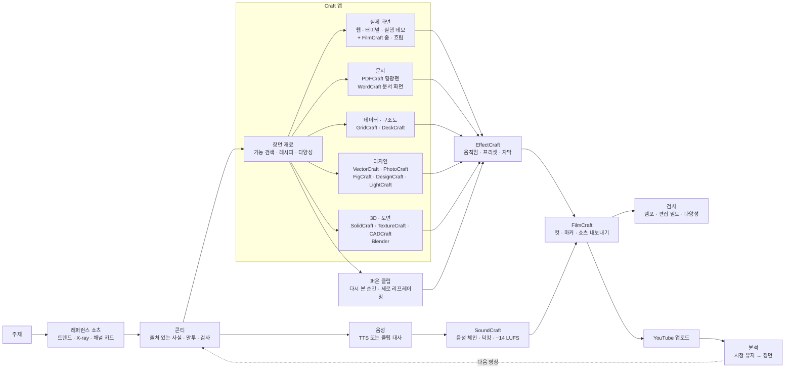

<div align="center">


# Fluma

**생성 모델에 돈을 쓰지 않고도 만드는 유튜브 쇼츠 — 이미 있는 2D 그래픽 · 이미지 · 영상을 편집자처럼 다시 엮고, 꼭 필요한 컷만 그림 시안부터 싸게 생성합니다.**

[](LICENSE)
[](QUICKSTART.ko.md)


[빠른 시작](QUICKSTART.ko.md) · [왜 Fluma](#왜-fluma) · [작동 방식](#작동-방식) · [기여하기](CONTRIBUTING.ko.md)

[English](README.md) · **한국어**

</div>

<p align="center"></p>

## Fluma 는

세로 숏폼(YouTube Shorts · 릴스 · 틱톡)을 만드는 로컬 에이전트 작업 공간입니다.
이미 쓰고 있는 **Claude Code · Codex** 에게 말하면, 에이전트가 잘 되는 쇼츠를 먼저 분석하고 **실제 자료**(웹 화면 · 문서 · 데이터 · 사진 · 퍼온 클립 · 스톡 영상)를 오픈소스 제작 앱으로 다듬어 영상으로 엮습니다.
기본은 생성 모델 없이(생성 비용 0) 만들고, 결과는 전부 열어서 고칠 수 있는 프로젝트 파일로 남습니다. 실제 자료로 안 되는 컷이 있을 때만 **오픈라우터 키 하나**로 그림 시안을 먼저 보여 주고, 고른 그림에서 영상을 만듭니다.

## 왜 Fluma

생성 영상 모델은 "없는 장면"을 만드는 데 강하지만, 쇼츠의 많은 부분은 **이미 있는 것을 잘 엮는 일**입니다 — 실제 앱 화면, 원문 문서, 정확한 숫자, 화제가 된 클립.
Fluma 는 이 틈새를 노립니다.

| | 생성 영상 모델 | Fluma |
|---|---|---|
| 비용 | 초 · 편 단위 과금, 다시 뽑을수록 더 | **생성 비용 0** — 내 에이전트 로그인 · 무료 음성 · 무료 스톡 |
| 글자 · 숫자 · 로고 | 자주 깨지고 지어냄 | 실제 문서 · 실제 화면 · 데이터 그대로 |
| 사실 | 출처 없음 | 사실마다 출처 URL, 없으면 버림 |
| 고치기 | 프롬프트 바꿔 처음부터 다시 | 장면 · 레이어 · 글자 하나만 고침(프로젝트 파일) |
| 매번 결과 | 운에 따라 다름 | 레퍼런스에서 잰 리듬 · 검사 통과 기준으로 일정 |
| 필요한 컴퓨터 | 클라우드 GPU | 보통 노트북(GPU 없어도 됨) |

**잘 맞는 영상**

- **정보 · 팁** — 툴 비교, 실제 화면 녹화 + 줌 · 강조(`format-compare`)
- **순위 · 레전드 모음** — 퍼온 클립의 가장 많이 다시 본 순간 · 세로 리프레이밍 · 반응 자막(`format-ranking` · `format-clip`)
- **시세 · 뉴스 · 매일 영상** — 데이터 카드를 틀에 채워 매일 찍기(`format-daily`)
- **근거 · 문서** — 원문 PDF 에 형광펜 · 확대(PDFCraft)
- **감성 · 광고** — 현장 사진 · 매장 영상 + 짧은 문장(`format-emotional` · `format-ad`)
- **2D 그래픽 · 일러스트** — 에이전트가 VectorCraft 로 직접 그린 그림 · 구조도 · 차트

**실사 생성이 필요한 컷** — 세상에 없는 장면(가상의 인물 연기, 상상 속 풍경)은 실제 자료로 못 만듭니다. 이런 컷이 있으면 Fluma 가 먼저 알려 주고, 원하면 **그림 시안부터** 만듭니다: 키프레임 그림 몇 장(장당 몇 센트) → 사용자가 고름 → 고른 그림으로 영상(비싼 단계는 확정 뒤에). 오픈라우터 키가 있으면 Fluma 가 직접(Seedance · Kling · Veo · Seedream · Nano Banana … 중 설정에서 고른 모델), 없으면 모델마다 문법에 맞춘 프롬프트만 써 줍니다. 영상 전체가 생성이어야 한다면 생성 도구를 직접 쓰는 편이 낫습니다.

## 드는 비용

| 필요한 것 | 비용 |
|---|---|
| 에이전트 | 이미 쓰는 Claude Code · Codex 로그인 그대로(또는 API 키) |
| 음성 | 무료 엔진 기본(Edge TTS · 로컬 TTS 6종) — 유료 음성은 오픈라우터 키 하나로(ElevenLabs · Gemini TTS · Fish Audio … 중 설정에서 고름) |
| 실사 자료 | 퍼온 클립(출처 자동 표기) · Pexels · Pixabay 무료 키 · 자료 사진 |
| 배경 곡 | 같은 분야 쇼츠가 실제로 붙이는 유행 곡을 찾아, 업로드 때 쇼츠 편집기 라이브러리에서 붙임(저작권 · 수익 문제 없음) |
| 제작 앱 | 오픈소스 [Craft 앱](#craft-앱) 16개 + Blender — 무료 |
| (선택) 오픈라우터 | 키 하나로 영상 이해(레퍼런스 분석) · 그림 · 영상 생성 · 음성 · 받아쓰기. 모델은 설정에서 능력마다 고르고, 영상 한 편 상한(기본 $3)을 넘으면 금액을 보여 주고 묻습니다 |

## 하는 일

1. **실제 쇼츠부터 봅니다** — 같은 주제 쇼츠를 찾아 분해하고(컷 · 카메라 움직임 · 색 · 말 · 화면 글자 · 화면 종류) 리듬과 말투만 가져옵니다. 내용은 가져오지 않습니다.
2. **출처 있는 사실로 콘티를 씁니다** — 그 채널의 말투로.
3. **장면마다 실제 제작 도구로 만듭니다** — Craft 앱 16개와 그 명령 · 효과 · 프리셋 9,000개 이상: 실제 화면 녹화, 주석 단 문서, 구조도, 앱 목업, 정보 카드, 3D 제품, 도면. 그다음 움직임 · 소리 · 컷 편집까지.
4. **있는 영상을 다시 씁니다** — 퍼온 클립에서 가장 많이 다시 본 구간을 고르고, 주인공을 따라가는 9:16 으로 다시 잡고, 원음을 살립니다. 출처는 설명란에 자동으로.
5. **영상마다 다르게** — 장면마다 앱 전체 기능에서 찾고, 최근 영상이 안 쓴 검증된 레시피를 고르고, 되풀이하면 알려 줍니다.
6. **검수자처럼 확인합니다** — 첫 1초, 멈춤, 말 끊김, 컷 밀도. 형식(순위 모음 · 클립)마다 기준이 다릅니다.
7. **올리고 배웁니다** — 내 채널에 올리고 시청 유지 곡선을 콘티 장면에 겹쳐 봅니다.

## 특징

- 🔎 **레퍼런스 먼저, 검사로 강제** — 실제 레퍼런스 쇼츠를 분석해 연결하기 전에는 콘티가 검사(`L30`)를 통과하지 못합니다. 명사로 끝나는 말 · 존댓말 반말 섞임도 실패(`L31`).
- 🧰 **실제 도구를 전부** — 단계마다 Craft 앱의 프로젝트 파일(`.ecproj` 움직임 · `.scraft` 소리 · `.fcproj` 컷 · `.vectorcraft` 그림 · `.psd` · `.deckcraft` …). 열어서 계속 고칠 수 있고, 사람이 고친 파일은 해시로 알아채 덮어쓰지 않습니다. 정해진 재료 종류로 안 되면 에이전트가 앱 명령을 직접 짭니다(`type: craft`).
- 👁️ **영상을 직접 보는 눈(VL)** — 오픈라우터 보기 모델이 레퍼런스 쇼츠를 처음부터 끝까지 보고 장면 · 훅 · 반전 · 편집 문법 · 자막 말투 · 붙잡는 장치를 시각과 함께 정리하고, 뻔함 지도 초안 · 클립에서 원하는 순간 찾기 · 초안 비평(몇 초에 무엇이 왜 어색한지) · 생성 컷 확인까지 합니다. 에이전트는 영상에 대해 무엇이든 물어볼 수 있습니다(`see.py ask`).
- 🎞️ **느낌(룩) 고르기** — 현실 다큐 · 몽환 · 필름 같은 느낌을 에이전트가 2~4안 제안하고, 같은 장면에 입힌 시안을 나란히 보여 줍니다(`feel.py`). 고른 느낌은 실사 재료 전부에 같은 색 · 질감으로, 실사 생성 프롬프트에도 들어갑니다.
- ♻️ **재활용 편집** — 클립 구간 자동 선택(`clip.py --best`), 주인공 추적 세로 리프레이밍(`reframe.py`), 유행 곡 찾기(`trend_music.py`), 업로드 안내(`upload_guide.py`).
- 🎨 **모양은 사용자가 고르고, 효과는 근거가 있을 때만** — 첫 장면들을 디자인 시안 2~3개로 나란히 렌더해 고르게 합니다. 배경 움직임 · 전환 · 글자 애니메이션은 레퍼런스나 요청이 없으면 꺼져 있습니다.
- 🎲 **같은 영상이 나오지 않게** — 모든 명령 · 효과 · 프리셋 검색(`craft_catalog.py`), 검증된 레시피, 최근 영상과 겹침 검사(`V41~V45`).
- ⏱️ **쇼츠 피드용** — 렌더마다 빈 첫 화면 · 첫 1초 변화 없음 · 긴 멈춤 · 말 끊김을 잽니다(`L32`, `T32~T34`).
- 📈 **실제 숫자로 다음 영상에** — 내 채널을 공식 OAuth 로 연결해 조회수 · 평균 시청 비율 · 유입 경로 · **장면별** 시청 유지를 봅니다.
- 💻 **어느 컴퓨터에서나** — Linux · macOS · Windows, Intel · AMD · ARM(Apple Silicon). Docker 는 GPU 가 있으면 자동 연결, 없으면 CPU 로.
- 🌐 **한국어 우선, 다국어** — 한국어 말투 분석 · 자막 문법, 화면은 English · 한국어 · 中文.
- 🔐 **로컬 우선** — 키와 YouTube 토큰은 `~/.shortsforge/`(0600)에 두고, 에이전트는 읽지 못합니다.

## 작동 방식



| 단계 | 위치 | 하는 일 |
|---|---|---|
| 레퍼런스 | `engine/research/`(`trends.py` · `shorts_xray.py` · `ref_channel.py`) | 주제로 쇼츠 찾기, 컷 · 카메라 · 색 · 말 · BPM · 화면 종류, 채널 말투 카드 |
| 콘티 | `.claude/skills/plan` · `storyboard`, `engine/checks/lint.py` | 장면 `materials`, 구조 검사 |
| 재료 | `engine/craft/materials.py` + `engine/craft/adapters/<앱>.py` | Craft 앱마다 어댑터 하나, `type: craft` 는 아무 명령 목록이나 실행 |
| 다양성 | `engine/craft/craft_catalog.py` · `craft_variety.py`, `.claude/skills/crafts/` | 기능 9,000개 이상 검색, 레시피, 반복 검사, 영상별 사용 기록 |
| 움직임 · 소리 · 편집 | `engine/craft/motion.py` · `audio.py` · `edit.py` | EffectCraft 컴포지션, SoundCraft 믹스, FilmCraft 조립 |
| 한 줄 제작 | `engine/produce.py` | 음성 → 검사 → 재료 · 초안 → 장면별 정지 화면 |
| 검사 | `engine/checks/` | 첫 1초 · 멈춤 · 말 끊김 · 컷 밀도, 의도 · 시안 관문 |
| 올리기 · 배우기 | `engine/publish/`, `studio/youtube.mjs` | OAuth, 재개 업로드, 분석을 장면에 매핑 |

## 편집기

VS Code 같은 작업 공간입니다. 왼쪽 **탐색기**는 영상이 무엇으로 이루어졌는지(편집 · 미리보기, 소리, 그래픽, 그림, 사진, 데이터, 게시 · 성과)를 보여 주고, 가운데는 고른 항목의 **결과물**(완성 영상 · 믹스 · 장면 그래픽 · 그림 · 표 · 통계)을 보여 줍니다. 수정은 오른쪽 에이전트에게 말로 — 고른 항목이 에이전트에게 함께 갑니다. 편집 탭 · 경로 표시줄 · 상태 표시줄, 탐색기 폭 조절과 접기(`Ctrl+B`).

<table>
<tr>
<td width="50%"><br/><sub><b>모델 · 공급자</b> — 내 Claude Code / Codex CLI, 또는 API 키</sub></td>
<td width="50%"><br/><sub><b>미디어</b> — 무료 · 유료 음성 엔진, 렌더 엔진</sub></td>
</tr>
</table>

## Craft 앱

Fluma 는 오픈소스 **Craft** 데스크톱 · 웹 앱([storytold](https://github.com/storytold), MIT / Apache-2.0)을 CLI 와 MCP 서버로 씁니다. **함께 들어 있지 않으니** 필요한 것을 설치하세요(16개 전부 약 1.7GB):

```bash
python3 engine/craft/crafts.py plan all        # 받을 것만 보여 줌
python3 engine/craft/crafts.py install all     # 또는 골라서: install effectcraft soundcraft filmcraft …
```

| 앱 | Fluma 가 쓰는 곳 |
|---|---|
| EffectCraft | 모든 장면의 움직임 — 내장 배경 · 등장 · 글자 프리셋, 화면 액자, 밀기 |
| SoundCraft | 음성 체인(EQ · 컴프레서 · 치찰음), 낱말마다 효과음, 덕킹, −14 LUFS |
| FilmCraft | 조립, 장면 마커, 쇼츠 내보내기, 썸네일 · 화면 녹화 줌 · 흐림 · 빨리 감기 · 클립 색 프리셋 |
| VectorCraft | 에이전트가 그리는 그림, 주석 레이어(박스 · 화살표 · 설명), CSV 카드 일괄 |
| PhotoCraft | 캡처로 9:16 장면 카드, 누끼, 글자 투명화, 정리 |
| PDFCraft | 원문 문서에 진짜 형광펜 · 박스, 고해상도로 자른 근거 컷, 가리기 |
| WordCraft | 형광펜 · 변경 추적이 있는 문서 화면 |
| GridCraft · DeckCraft | 차트용 데이터, SmartArt 구조도 · 표 |
| FigCraft · DesignCraft | 폰 · 브라우저 목업, 한글 조판 정보 카드 · 썸네일 |
| LightCraft | 한 영상의 사진들을 같은 톤으로 |
| SolidCraft · TextureCraft · CADCraft | 3D 제품 돌려 보기 · 분해, 평면도 · 도면 |
| Blender | 곡면 · 캐릭터 · Cycles 고품질 렌더(영상마다 스크립트). SolidCraft 부품 · 관절과 TextureCraft 재질을 받아 이어서 쓴다(`engine/craft/bridge3d.py`) |

앱마다 전체 명령 목록은 `.claude/skills/crafts/catalog/`(`python3 engine/craft/craft_catalog.py search "곡선 화살표"`), 시험해 본 사용법은 `.claude/skills/crafts/reference/` 에 있습니다. 릴리스는 SHA256SUMS 로 검증해 `tools/crafts/`(git 제외)에 풉니다.

## YouTube 연결

설정 → **YouTube**: Google Cloud 에서 OAuth 클라이언트를 만들고(*YouTube Data API v3* · *YouTube Analytics API* 사용, 웹 애플리케이션, 리디렉션 URI `http://127.0.0.1:4310/api/youtube/callback`), ID · 비밀을 넣고 **연결**. 화면의 단계 안내를 따라 하면 됩니다.

- 편집기 **게시 · 성과**: 마지막 렌더를 올리거나(기본 비공개) 이미 올린 영상과 연결
- **내 채널 영상**: 채널의 아무 영상이나 통계 보기

분석 숫자는 게시 1~2일 뒤부터 채워집니다. '시청 vs 스와이프'는 YouTube Studio 에만 있어서, Fluma 는 가장 가까운 API 값인 **참여 조회 ÷ 조회**를 보여 줍니다.

## 빠른 시작

필요: Python 3.10+, Node.js 20+, ffmpeg. 자세한 내용과 문제 해결: [빠른 시작](QUICKSTART.ko.md)

```bash
git clone https://github.com/meowassassin/fluma && cd fluma
python3 engine/doctor.py --fix              # 전부: 파이썬 패키지 · Craft 앱 16개 · 모델 · npm
npm --prefix studio run dev                     # → http://localhost:4311
```

- 어떤 방법으로 설치할지(Docker · 바로 설치 · 개발) · 컴퓨터 사양 · 영상이 어디 저장되는지: [빠른 시작](QUICKSTART.ko.md#나에게-맞는-방법-고르기)
- 최소 설치: `python3 engine/doctor.py --fix --profile lite --core`(나머지는 처음 쓸 때 스스로 설치)
- Docker(전부 포함 · OS · GPU 자동): `sh docker/start.sh`(Linux · macOS) · `docker\start.ps1`(Windows)
- 내 에이전트에게 맡기기: Claude Code · Codex 에게 이 스킬 주소 — https://raw.githubusercontent.com/meowassassin/fluma/main/docs/skill/SKILL.md

## 스킬

| 스킬 | 하는 일 |
|---|---|
| `plan` | 대화로 기획, 콘티 전에 레퍼런스 쇼츠 분석 |
| `storyboard` | 콘티 JSON: 형식 · 조사 · 장면 · 재료 · 검사 |
| `produce` | Craft 파이프라인: 음성 → 재료 → 검사 → 초안 → 정지 화면 확인 |
| `crafts` | 장면마다 어느 Craft 앱 · 기능을 쓸지 — 기능 검색 · 레시피 · 다양성 규칙 |
| `illustrate` | VectorCraft 로 디자이너처럼 그리기(렌더해서 보고 고치기) |
| `research` | 출처 URL 있는 사실 모으기 — 5개 미만이면 만들지 않음 |
| `trends` | 주제 · 해시태그로 쇼츠 찾기 |
| `voice` · `scene-edit` · `character` | 음성 맞추기 · 장면 하나 고치기 · 립싱크 마스코트 |
| `refine` | 초안 뒤 장면마다 디테일 다듬기(시도 → 전 · 후 비교 → 남김) |
| `format-*` | 비교 · 시세 · 광고 · 감성 · 순위 모음 · 클립 반응 형식 |

## 구조

```text
fluma/
├─ engine/                 파이썬 제작 엔진
│  ├─ produce.py           한 줄 제작: 콘티 → 음성 → 검사 → 초안 → 정지 화면
│  ├─ render.py · pipeline.py · doctor.py · fluma_agent.py · mcp_server.py
│  ├─ craft/               Craft 파이프라인 — 재료 · 움직임 · 소리 · 편집 · design.py(영상마다 효과) · adapters/<앱>.py
│  │  ├─ apps/             Craft 앱 16개 등록(앱마다 craft.json)
│  │  ├─ renderer/         렌더 엔진 등록(engine.json · adapter)
│  │  └─ craft_catalog.py · craft_variety.py · crafts.py
│  ├─ voice/               TTS · 음성 조립 · 목소리 맞추기 · engines/<음성> · sfx
│  ├─ research/            트렌드 · 쇼츠 X-ray · 레퍼런스 스타일 · 채널 카드
│  ├─ capture/             웹 · 터미널 녹화 · 실행 데모 · 퍼온 클립 · 세로 리프레이밍 · 짤 · 스톡 · 아이콘
│  ├─ story/               콘티 도우미 — 콘셉트 · 느낌(feel.py) · 디자인 시안(directions.py) · 여러 버전 · 말투 고치기
│  ├─ gen/                 실사 생성 — 모델별 프롬프트 · 그림 시안 → 고르기 → 영상(오픈라우터) · 올린 클립 확인
│  ├─ providers/           오픈라우터 하나 — 능력별 모델 목록 · 고른 모델 · 비용 관문(예상 → 승인 → 장부)
│  ├─ checks/              검사 · 템포 · 편집 밀도 · 관문
│  ├─ publish/             YouTube 업로드
│  ├─ core/                공용 — 결과 규약 · 엔진 등록 · 마무리 · 정지 화면 · 설치
│  └─ spec/                schema · rules · presets · tokens
├─ studio/                 웹 앱 — React 화면(src/) · API 서버 · 에이전트 하네스(agent/system.md)
├─ .claude/skills/         에이전트 스킬(plan · storyboard · produce · crafts …)
├─ data/                   작업하며 생기는 것 전부(git 제외) — data/README.md
├─ docker/                 Dockerfile · docker-compose.yml · start.sh · start.ps1(OS · GPU 자동)
├─ docs/  tests/
└─ tools/                  설치한 Craft 앱(git 제외)
```

| 층 | 기술 |
|---|---|
| 스튜디오 화면 | React + Vite(`studio/src`), 다국어 en / ko / zh |
| API · 에이전트 실행 | Node / Express(`studio/server.mjs` · `studio/agent.mjs`) — 내 CLI 또는 API, Craft 앱은 MCP 서버 |
| 엔진 | Python(`engine/`) — 렌더 엔진은 Craft 파이프라인 하나 |
| 플러그인 | 폴더 하나씩: `engine/craft/apps/<앱>/craft.json` · `engine/craft/adapters/<앱>.py` · `engine/voice/engines/<이름>/` |

## 로드맵

- [x] 레퍼런스 먼저 · 강제 검사(L30 · L31)
- [x] 고칠 수 있는 프로젝트 파일이 남는 Craft 앱 파이프라인
- [x] 항목별 결과를 보여 주는 IDE 형 편집기
- [x] YouTube 연결 · 업로드 · 장면별 통계
- [x] 쇼츠 피드용 렌더 템포 검사
- [ ] 지난 영상의 장면별 이탈을 훅 기획에 자동 반영
- [ ] 화면 다듬기: 위쪽 고정 제목 · 사진 동그라미 강조 · 핵심어 색 자막
- [ ] 수작업 · 성과 숫자를 함께 보여 주는 공개 데모 한 편
- [x] Linux · macOS · Windows · ARM CI, amd64 · arm64 Docker 이미지
- [x] 클립 재활용: 다시 본 구간 · 세로 리프레이밍 · 유행 곡 안내

## 기여하기

**누구나 환영합니다 — 허락은 필요 없어요.** 포크해서 마음껏 고치고 PR · 실험 · 수정 · 번역 · 아이디어를 보내 주세요. [기여하기](CONTRIBUTING.ko.md)

## 상태

초기 단계입니다. CI 에서 Linux(x86 · ARM) · macOS · Windows · Docker 를 시험합니다. 레퍼런스는 *구조*만 분석하며 영상 · 목소리 · 그림 · 대본을 베끼지 않습니다. 퍼온 클립 · 짤 · 음악 · 로고의 권리는 원작자에게 있고, 사용 판단은 사용자 책임입니다(출처는 설명란에 자동으로 남깁니다).

## 라이선스

Apache-2.0 — [LICENSE](LICENSE), [NOTICE](NOTICE). Craft 앱은 각자의 라이선스를 따르는 별도 프로젝트입니다.
