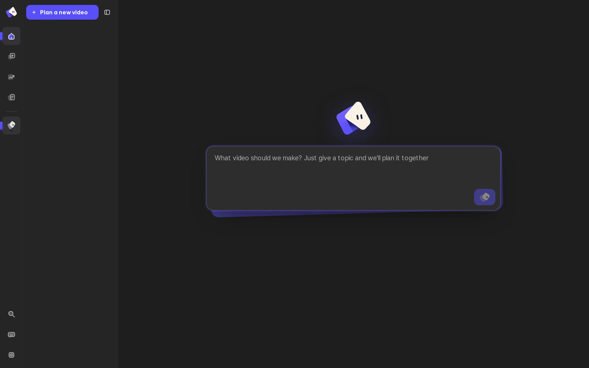

<div align="center">


# Fluma

**참고 쇼츠를 붙여 넣으면, 그 편집 문법을 숫자로 재서 내 주제로 다시 만든다 — 실제 재료로, 만들기 전에 미리 보고, 사람이 편집한 쇼츠 기준으로 검사해서.**

[](LICENSE)
[](QUICKSTART.md)


[](CONTRIBUTING.md)

[빠른 시작](QUICKSTART.md) · [기여하기 — 누구나 환영](CONTRIBUTING.md) · [동작 방식](#동작-방식)

[English](README.md) · **한국어**

</div>

<p align="center"></p>

## Fluma 는

숏폼(유튜브 쇼츠 · 릴스 · 틱톡)을 만드는 로컬 에이전트 작업 공간입니다. 에이전트(내 Claude Code · Codex CLI, 또는 API 키)와 대화하면
참고 쇼츠나 채널을 분석하고, **내 주제**로 콘티를 쓰고, 돈 · 시간이 드는 작업 전에 **미리 보기**를 보여 주고, 장면마다 화면을 코드로 짜고(HyperFrames),
나레이션과 음악을 넣고, 사람이 편집한 쇼츠에서 잰 숫자로 결과를 검사한 뒤 1080×1920 MP4 로 뽑습니다.

Fluma 는 **실사 영상을 생성하지 않습니다.** 2D 화면과 이미 있는 재료(실제 웹사이트 화면 녹화 · 짤 · 캐릭터 · 라이브러리 요소 · 직접 올린 파일)로 만듭니다 —
화면 속 사실 · UI · 숫자가 지어낸 것이 아니라 진짜입니다.

## 왜 Fluma 인가

- 🎯 **참고 쇼츠의 문법을 숫자로** — 고정 제목 · 펀치라인 상자 · 상황 괄호 · 반응 자막의 위치 · 크기 · 색, 컷 박자, 음악 BPM, 문장 끝을 참고 쇼츠(또는 채널 여러 편)에서 재서 그대로 씁니다.
- 🧾 **지어낸 화면 대신 실제 재료** — 실제 브라우저를 조작하며 녹화하고, 말하는 단어에 맞춰 화면 속 글자를 찾아 확대합니다. 출처 없는 사실은 버립니다.
- 🎬 **만들기 전에 미리 보기** — 콘티만으로 미리 보기 영상을 뽑습니다. 없는 재료는 무엇이 들어갈지 적힌 자리표시로, 자막 · 타이밍 · 음성은 실제와 같게.
- 📏 **사람이 편집한 쇼츠 기준으로 검사** — '슬라이드 같음'(작은 글자 · 재료 한 종류 · 변화 없음)과 'AI 티'(기울기 · 빛번짐 · 흐림 등장 · 그라데이션)를 렌더 화면에서 재서 최종 렌더를 막습니다.
- 💬 **말로 고치기** — 미리보기를 짚고 말하면 그 장면 · 그 단어만 고칩니다. 사람이 한 일은 모두 기록돼 '손이 얼마나 갔는지'가 숫자로 남습니다.
- 🎵 **목소리와 음악** — 무료 Edge 음성 또는 Typecast · ElevenLabs · Gemini TTS, 참고 화자에 맞춰 고르는 목소리(복제 아님), 나레이션 밑에 깔리는 배경음악(말할 때 자동으로 줄임).
- 🌐 **한국어 우선, 여러 언어** — 한국어 말투 분석 · 자막 문법, 화면은 English · 한국어 · 中文.
- 💸 **무료로 끝까지, 로컬 우선** — 무료 음성 + 로컬 렌더 + 무료 2D 모델. 키는 `~/.shortsforge/`(0600)에만, 에이전트는 못 읽습니다.

## 동작 방식

1. **분석** — 참고 쇼츠 분해(`shorts_xray.py`), 스타일 카드(`ref_style.py`), 채널 카드(`ref_channel.py`)
2. **의도 카드** — 누구에게 · 무엇을 · 참고에서 무엇을 가져올지, 사용자가 확인
3. **콘티** — 장면 · beats(문장 안 재료 전환) · 화면 문법(`previz.py grammar`), 검사(`lint.py`)
4. **미리 보기** — `previz.py render` 로 콘티만으로 대충 만든 영상
5. **재료** — 웹 녹화(`webrec.py`) · 짤(`meme.py`, 출처 기록) · 캐릭터 · 올린 파일
6. **화면 · 목소리 · 음악** — `scene.js`(HyperFrames) · `voice_match.py` · `finish.py`
7. **시안** 장면 1~3 → 사용자 승인 → **렌더** (관문 `gate.py`, 편집 밀도 · 'AI 티' 검사)

## 빠른 시작

필요한 것: Python 3.10+, Node.js 20+, ffmpeg. 자세한 내용은 [QUICKSTART.md](QUICKSTART.md).

```bash
git clone <저장소> fluma && cd fluma
python3 scripts/doctor.py --fix          # 가벼운 시작: 콘티 · 무료 Edge 음성 · HyperFrames · 렌더 · 검사
npm --prefix web run dev                 # → http://localhost:4311
```

- 레퍼런스 분석(받아쓰기 · OCR · 화면 분류): `python3 scripts/doctor.py --fix --profile analysis`
- Docker: `docker compose up --build`
- 무엇이 용량을 차지하는지 · 지워도 되는지: `python3 scripts/doctor.py --sizes`

## 코딩 에이전트에서 쓰기

- 에이전트 스킬: [`skills/reference-to-shorts/`](skills/reference-to-shorts/SKILL.md) — 참고 · 채널 분석만 따로
- MCP 서버(stdio): `python3 scripts/mcp_server.py` — `analyze_reference` · `channel_card` · `style_card` · `voice_profile`

## 로드맵

- [x] 참고 · 채널 분석 → 숫자로 잰 자막 문법 · 리듬
- [x] 말하는 단어에 맞춰 화면 글자를 찾아 확대하는 실제 화면 녹화
- [x] 콘티만으로 미리 보기(프리비즈)
- [x] 사람이 편집한 쇼츠 기준의 편집 밀도 · 'AI 티' 검사
- [x] 배경음악(말할 때 줄임) · 화면 언어 English / 한국어 / 中文
- [ ] 사람 손 · 시간 · 품질 숫자를 붙인 공개 데모 한 편
- [ ] 깨끗한 컴퓨터에서 Docker 한 줄 실행 검증
- [ ] macOS · Windows 자동 시험(설치 점검 · 테스트 · 짧은 렌더)
- [ ] 한 줄 설치

## 함께 만들기

**누구나 환영합니다 — 허락받을 필요 없어요.** 자유롭게 포크하고 고치고, 풀 리퀘스트 · 새 기능 · 개선 · 실험 · 버그 수정 · 번역 · 아이디어 무엇이든 보내 주세요.
덜 다듬어진 초안 PR 도 좋습니다. 시작하기 쉬운 곳은 [CONTRIBUTING.md](CONTRIBUTING.md) 에 있어요.

## 상태

초기 단계입니다. Linux 에서만 시험했습니다(macOS · Windows 경로 처리는 코드에 있지만 실제로 돌려 본 적은 없음).
참고 영상은 *구조*만 분석하고 화면 · 목소리 · 대본은 가져오지 않습니다 — 직접 넣는 짤 · 음악 · 로고 · 영상의 권리는 사용자 책임입니다.

## 라이선스

Apache-2.0 — [LICENSE](LICENSE), 서드파티 구성 요소는 [NOTICE](NOTICE).
