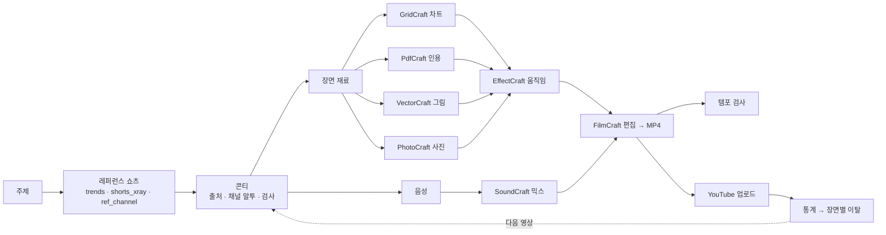

<div align="center">


# Fluma

**편집자처럼 유튜브 쇼츠를 만드는 에이전트 — 먼저 잘 되는 쇼츠를 분석하고, 실제 제작 툴로 장면을 만들고, 올린 뒤의 실제 성과로 다음 영상을 고칩니다.**

[](LICENSE)
[](QUICKSTART.md)


[빠른 시작](QUICKSTART.md) · [작동 방식](#작동-방식) · [기여하기](CONTRIBUTING.md)

[English](README.md) · **한국어**

</div>

<p align="center"></p>

## Fluma 는

세로 숏폼(유튜브 쇼츠 · 릴스 · 틱톡)을 만드는 로컬 에이전트 작업 공간입니다. 에이전트(내 Claude Code / Codex CLI, 또는 API 키)와 대화하면

1. **먼저 실제 쇼츠를 분석합니다** — 같은 주제의 쇼츠를 찾아 컷 · 말 · 문장 끝 · 화면 글자 · 화면 종류를 분해하고, 리듬과 말투만 가져옵니다(내용은 베끼지 않음).
2. **출처 있는 사실로 콘티를 씁니다** — 그 채널의 말투로.
3. **실제 제작 툴로 장면을 만듭니다** — 오픈소스 [Craft 앱](#craft-앱): 표 데이터 → 차트, PDF 인용 → 형광펜 확대, 에이전트가 그린 벡터 그림 → 움직이는 레이어, 그리고 모션 그래픽 · 소리 믹스 · 컷 편집. 단계마다 고칠 수 있는 프로젝트 파일이 남습니다.
4. **렌더를 검사합니다** — 첫 1초 · 멈춘 화면 · 말 끊김 · 컷 밀도.
5. **올리고 배웁니다** — 내 채널에 올리고, 이탈 곡선을 콘티 장면에 겹쳐 '어느 장면에서 넘겼나'를 다음 영상에 반영합니다.

실사 영상은 생성하지 않습니다. 출처 URL 이 없는 사실은 버립니다.

## 특징

- 🔎 **레퍼런스 먼저(강제)** — 분석한 레퍼런스 쇼츠를 콘티에 연결하지 않으면 검사 실패(`L30`). 명사로 뚝 끊기거나 존댓말 · 반말이 섞인 대사도 실패(`L31`).
- 🧰 **템플릿 엔진 대신 실제 툴** — 단계마다 Craft 앱 프로젝트 파일(`.ecproj` 움직임 · `.scraft` 소리 · `.fcproj` 컷 · `.vectorcraft` 그림). 사람이 열어 고치면 해시로 알아채 덮어쓰지 않습니다.
- 🎨 **에이전트가 디자이너처럼 그림** — `illustrate` 스킬: 레퍼런스 그림 문법 연구 → 실루엣 썸네일 → VectorCraft 로 그리기 → 렌더해서 보고 고치기 → 부품 이름. 캐릭터는 그 부품으로 걷고 · 손 흔들고 · 튑니다.
- ⏱️ **쇼츠 피드에 맞춤** — 유튜브의 핵심 신호는 '넘기지 않고 보는가'. 렌더마다 빈 첫 프레임 · 첫 1초 무변화 · 긴 멈춤 · 말 끊김을 잽니다(`L32`, `T32~T34`).
- 📈 **실제 숫자로 고리를 닫음** — 공식 OAuth 로 채널 연결 → 업로드 → 조회 · 참여 조회 · **넘기지 않고 본 비율(참여 ÷ 조회)** · 평균 시청 비율 · 유입 경로 · 시청자 · **장면별 이탈 곡선**.
- 🌐 **한국어 우선, 다국어** — 한국어 말투 분석 · 자막 문법, 화면은 English · 한국어 · 中文.
- 🔐 **로컬 우선** — 키와 YouTube 토큰은 `~/.shortsforge/`(0600)에만. 에이전트는 읽지 못합니다.

## 작동 방식



| 단계 | 위치 | 하는 일 |
|---|---|---|
| 레퍼런스 | `scripts/trends.py`, `shorts_xray.py`, `ref_channel.py` | 주제로 쇼츠 찾기, 컷 · 말 · 음악 박자 · 자막 띠 · 화면 종류, 채널 말투 카드 |
| 콘티 | `.claude/skills/plan`, `storyboard`, `scripts/lint.py` | 장면마다 재료(chart · doc_quote · illustration · photo · screen), 구조 검사 |
| 재료 | `scripts/craft/materials.py` | 앱마다 적힌 능력 목록(`provides`)을 보고 Craft 앱을 골라 재료를 만듦 |
| 움직임 · 소리 · 편집 | `scripts/craft/motion.py`, `audio.py`, `edit.py`, `engines/craft/` | 장면별 EffectCraft 컴포지션, SoundCraft 믹스, FilmCraft 조립 |
| 검사 | `scripts/tempo_check.py`, `edit_density.py`, `gate.py` | 첫 1초 · 멈춤 · 말 끊김 · 컷 밀도, 최종 렌더 전 의도 · 시안 확인 |
| 게시 · 학습 | `web/youtube.mjs` | OAuth, 재개 가능 업로드, 분석 API 리포트를 장면에 매핑 |

## 편집기

VS Code 같은 작업 공간입니다. 왼쪽 **탐색기**는 영상이 무엇으로 이루어졌는지(편집 · 미리보기, 소리, 그래픽, 그림, 사진, 데이터, 게시 · 성과)를 보여 주고, 가운데는 고른 항목의 **결과물**(완성 영상 · 믹스 · 장면 그래픽 · 그림 · 표 · 통계)을 보여 줍니다. 수정은 오른쪽 에이전트에게 말로 — 고른 항목이 에이전트에게 함께 갑니다. 편집 탭 · 경로 표시줄 · 상태 표시줄, 탐색기 폭 조절과 접기(`Ctrl+B`).

<table>
<tr>
<td width="50%"><br/><sub><b>모델 · 공급자</b> — 내 Claude Code / Codex CLI, 또는 API 키</sub></td>
<td width="50%"><br/><sub><b>미디어</b> — 무료 · 유료 음성 엔진, 렌더 엔진</sub></td>
</tr>
</table>

## Craft 앱

오픈소스 **Craft** 앱([storytold](https://github.com/storytold), MIT / Apache-2.0)을 명령행 · MCP 로 씁니다. 저장소에 포함되지 않으니 필요한 것만 설치하세요(16개 전부 약 1.7GB):

```bash
python3 scripts/crafts.py plan all        # 받을 파일 · 크기만 보기(받지 않음)
python3 scripts/crafts.py install all     # 또는: install effectcraft soundcraft filmcraft vectorcraft gridcraft pdfcraft photocraft
```

SHA256SUMS 로 검증해 `tools/crafts/`(git 제외)에 풉니다. 파이프라인에 쓰는 것: EffectCraft · SoundCraft · FilmCraft · VectorCraft · GridCraft · PdfCraft · PhotoCraft. 나머지(LightCraft · FigCraft · DeckCraft · DesignCraft · WordCraft · CADCraft · SolidCraft · TextureCraft · Craft Anything)는 에이전트가 MCP 로 씁니다. Craft 앱이 없으면 HyperFrames 엔진으로 대신 렌더합니다.

## YouTube 연결

설정 → **YouTube**: Google Cloud 에서 OAuth 클라이언트를 만들고(*YouTube Data API v3* · *YouTube Analytics API* 사용, 웹 애플리케이션, 리디렉션 URI `http://127.0.0.1:4310/api/youtube/callback`), ID · 비밀을 넣고 **연결**. 화면의 단계 안내를 따라 하면 됩니다.

- 편집기 **게시 · 성과**: 마지막 렌더를 올리거나(기본 비공개) 이미 올린 영상과 연결
- **내 채널 영상**: 채널의 아무 영상이나 통계 보기

분석 숫자는 게시 1~2일 뒤부터 채워집니다. '시청 vs 스와이프'는 YouTube Studio 에만 있어서, Fluma 는 가장 가까운 API 값인 **참여 조회 ÷ 조회**를 보여 줍니다.

## 빠른 시작

필요: Python 3.10+, Node.js 20+, ffmpeg. 자세한 내용과 문제 해결: [QUICKSTART.md](QUICKSTART.md)

```bash
git clone https://github.com/meowassassin/fluma && cd fluma
python3 scripts/doctor.py --fix              # 기본: 콘티 · 무료 음성 · 렌더 · 검사
python3 scripts/crafts.py install all        # Craft 앱(위 참고)
npm --prefix web run dev                     # → http://localhost:4311
```

- 레퍼런스 분석(받아쓰기 · OCR · 화면 분류): `python3 scripts/doctor.py --fix --profile analysis`
- Docker: `docker compose up --build`

## 스킬

| 스킬 | 하는 일 |
|---|---|
| `plan` | 대화로 기획, 콘티 전에 레퍼런스 쇼츠 분석 |
| `storyboard` | 콘티 JSON: 형식 · 조사 · 장면 · 재료 · 검사 |
| `produce` | Craft 파이프라인: 음성 → 재료 → 검사 → 초안 → 정지 화면 확인 |
| `illustrate` | VectorCraft 로 디자이너처럼 그리기(렌더해서 보고 고치기) |
| `research` | 출처 URL 있는 사실 모으기 — 5개 미만이면 만들지 않음 |
| `trends` | 주제 · 해시태그로 쇼츠 찾기 |
| `voice` · `scene-edit` · `character` | 음성 맞추기 · 장면 하나 고치기 · 립싱크 마스코트 |
| `format-*` | 비교 · 시세 · 광고 · 감성 형식 |
| `compose` | HyperFrames 전용(대체 엔진) |

## 구조

| 층 | 기술 |
|---|---|
| 화면 | React + Vite(`web/src`), en / ko / zh |
| API · 에이전트 | Node / Express(`web/server.mjs`, `web/agent.mjs`) — 로컬 CLI 또는 API, Craft 앱은 MCP 서버로 |
| 파이프라인 | Python(`scripts/`) — 분석 · 검사 · 음성 · 재료 · 렌더 |
| 엔진 | `engines/craft`(기본), `engines/hyperframes`(대체), Manim · Blender 는 레이어 요소 |
| 확장 | 폴더 하나씩: `crafts/<앱>/craft.json`, `voices/<이름>/`, `genmodels/<이름>/`, `engines/<이름>/` |

## 로드맵

- [x] 레퍼런스 먼저 · 강제 검사(L30 · L31)
- [x] 고칠 수 있는 프로젝트 파일이 남는 Craft 앱 파이프라인
- [x] 항목별 결과를 보여 주는 IDE 형 편집기
- [x] YouTube 연결 · 업로드 · 장면별 통계
- [x] 쇼츠 피드용 렌더 템포 검사
- [ ] 지난 영상의 장면별 이탈을 훅 기획에 자동 반영
- [ ] 화면 다듬기: 위쪽 고정 제목 · 사진 동그라미 강조 · 핵심어 색 자막
- [ ] 수작업 · 성과 숫자를 함께 보여 주는 공개 데모 한 편
- [ ] macOS / Windows CI

## 기여하기

**누구나 환영합니다 — 허락은 필요 없어요.** 포크해서 마음껏 고치고 PR · 실험 · 수정 · 번역 · 아이디어를 보내 주세요. [CONTRIBUTING.md](CONTRIBUTING.md)

## 상태

초기 단계이고 Linux 에서만 시험했습니다. 레퍼런스는 *구조*만 분석하며 영상 · 목소리 · 그림 · 대본을 베끼지 않습니다. 직접 넣는 짤 · 음악 · 로고 · 영상의 권리는 사용자 책임입니다.

## 라이선스

Apache-2.0 — [LICENSE](LICENSE), [NOTICE](NOTICE). Craft 앱은 각자의 라이선스를 따르는 별도 프로젝트입니다.
