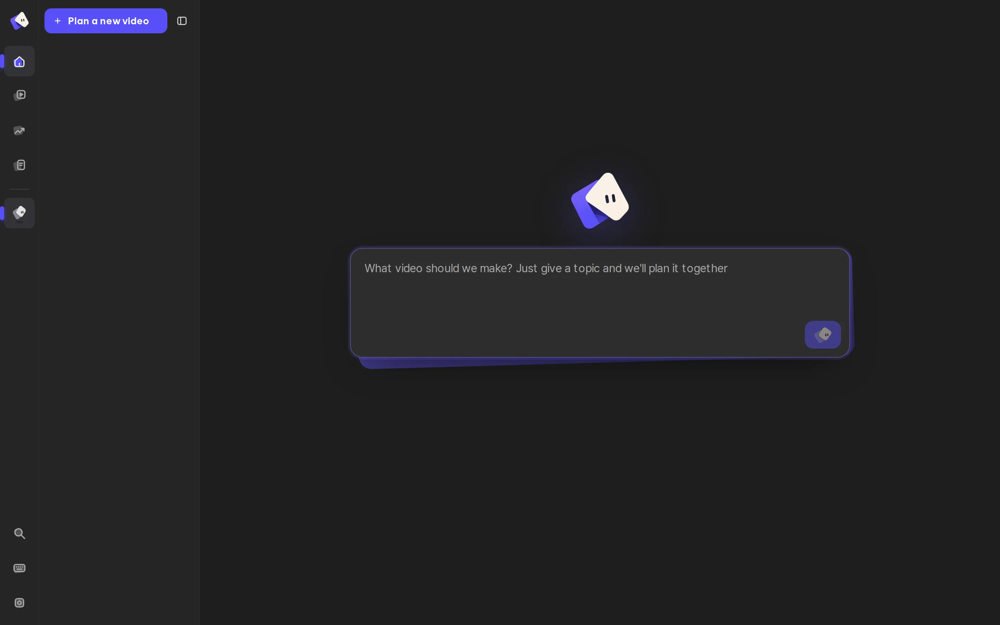
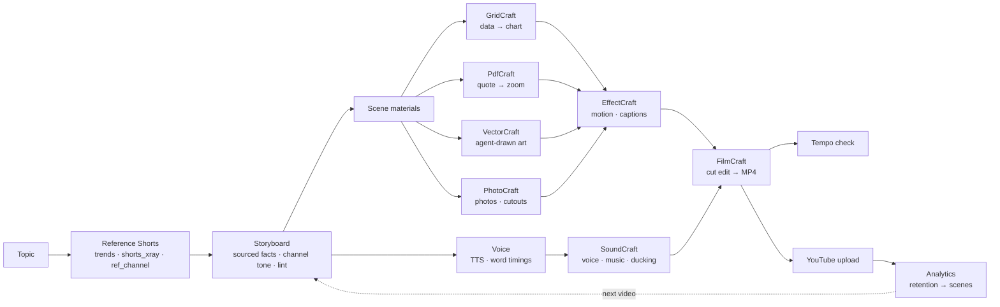
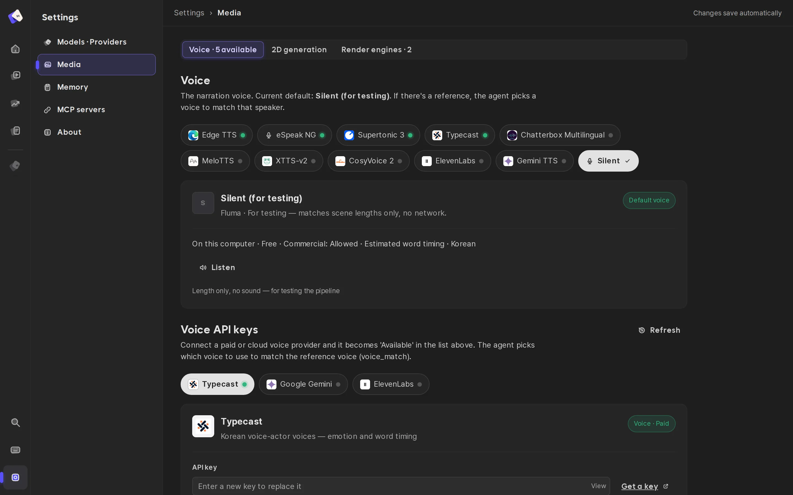

<div align="center">


# Fluma

**An agent that makes YouTube Shorts the way an editor would — studying real Shorts first, then building every scene in real creative tools, and learning from how the video actually performed.**

[](LICENSE)
[](QUICKSTART.md)


[](CONTRIBUTING.md)

[Quick start](QUICKSTART.md) · [How it works](#how-it-works) · [Contributing — all welcome](CONTRIBUTING.md)

**English** · [한국어](README.ko.md)

</div>

<p align="center"></p>

## What is Fluma

Fluma is a local-first agent workspace for vertical short-form video (YouTube Shorts · Reels · TikTok).
You chat with an agent (your own Claude Code / Codex CLI, or an API key). It:

1. **studies real Shorts first** — finds Shorts on the same topic, breaks them down (cuts, speech, sentence endings, on-screen text, screen types) and takes their rhythm and tone, never their content;
2. **writes a storyboard** with sourced facts, in that channel's spoken style;
3. **builds every scene in real creative tools** — the open-source [Craft apps](#the-craft-apps): spreadsheet data → charts, PDF quotes → highlighted zoom, vector illustrations drawn by the agent → animated layers, then motion graphics, an audio mix and a cut edit, each as an editable project file;
4. **checks the render** like a reviewer — the first second, freezes, gaps in speech, cut density;
5. **publishes and learns** — uploads to your channel and maps the retention curve back onto the storyboard's scenes, so the next video avoids the scene where people swiped away.

Fluma does **not** generate live-action video. Facts need a source URL or they are dropped.

## Why Fluma

- 🔎 **Reference first, enforced** — a storyboard fails the check (`L30`) until real reference Shorts have been analyzed and linked; narration that ends on a bare noun or mixes polite and casual speech fails too (`L31`).
- 🧰 **Real tools instead of a template engine** — every stage is a project file in a Craft app (`.ecproj` motion, `.scraft` audio, `.fcproj` cut, `.vectorcraft` art). You can open any of them and keep editing; Fluma notices hand edits by hash and never overwrites them.
- 🎨 **The agent draws like a designer** — the `illustrate` skill: study the reference's drawing grammar → silhouette thumbnails → draw in VectorCraft → render, look, fix → named parts. Characters can walk, wave or bounce from those parts.
- ⏱️ **Built for the Shorts feed** — YouTube's core signal is whether people stay instead of swiping away. Every render is measured for an empty first frame, no change in the first second, long freezes and pauses (`L32`, `T32–T34`).
- 📈 **Closes the loop with real numbers** — connect your channel (official OAuth), upload, and see views, engaged views, *stayed-to-watch* (engaged ÷ views), average % viewed, traffic sources, audience and the retention curve **per storyboard scene**.
- 🌐 **Korean-first, multilingual** — Korean tone analysis and caption grammar; UI in English, 한국어 and 中文.
- 🔐 **Local-first** — keys and YouTube tokens live in `~/.shortsforge/` (0600); the agent cannot read them.

## How it works



| Stage | Where | What it does |
|---|---|---|
| References | `scripts/trends.py`, `shorts_xray.py`, `ref_channel.py` | find Shorts by topic, cuts · speech · music BPM · caption bands · screen kinds, channel tone card |
| Storyboard | `.claude/skills/plan`, `storyboard`, `scripts/lint.py` | scenes with `materials` (chart · doc_quote · illustration · photo · screen), structural lint |
| Materials | `scripts/craft/materials.py` | picks the Craft app from each app's `provides` list and makes the material |
| Motion · audio · edit | `scripts/craft/motion.py`, `audio.py`, `edit.py`, `engines/craft/` | EffectCraft comps per scene, SoundCraft mix, FilmCraft assembly |
| Checks | `scripts/tempo_check.py`, `edit_density.py`, `gate.py` | first second · freezes · pauses · cut density; intent & draft gates before the final render |
| Publish & learn | `web/youtube.mjs` | OAuth, resumable upload, Analytics API reports mapped to scenes |

## The editor

An IDE-style workspace: an **Explorer** tree of what the video is made of — *Edit · Preview*, *Sound* (narration · music), *Graphics*, *Illustrations*, *Photos*, *Data*, *Publish · Results* — and an editor area that shows the **result** of the selected item (the cut, the mix, the scene graphics, the drawing, the table, the stats). Changes go through the agent panel on the right; the selected item is passed to the agent as context. Editor tabs, breadcrumbs, a status bar and a resizable explorer (`Ctrl+B`).

<table>
<tr>
<td width="50%"><br/><sub><b>Models · Providers</b> — your local Claude Code / Codex CLI, or any API key.</sub></td>
<td width="50%"><br/><sub><b>Media</b> — free and paid voice engines, render engines.</sub></td>
</tr>
</table>

## The Craft apps

Fluma drives the open-source **Craft** desktop/web apps (by [storytold](https://github.com/storytold), MIT / Apache-2.0) through their CLIs and MCP servers. They are **not bundled** — install the ones you want (about 1.7 GB download for all 16):

```bash
python3 scripts/crafts.py plan all        # what would be downloaded, no download
python3 scripts/crafts.py install all     # or: install effectcraft soundcraft filmcraft vectorcraft gridcraft pdfcraft photocraft
```

Releases are verified against their SHA256SUMS and unpacked into `tools/crafts/` (git-ignored). Used in the pipeline: EffectCraft, SoundCraft, FilmCraft, VectorCraft, GridCraft, PdfCraft, PhotoCraft. The others (LightCraft, FigCraft, DeckCraft, DesignCraft, WordCraft, CADCraft, SolidCraft, TextureCraft, Craft Anything) are available to the agent over MCP. Without Craft apps Fluma falls back to its HyperFrames engine.

## YouTube

Settings → **YouTube**: create an OAuth client in Google Cloud (enable *YouTube Data API v3* and *YouTube Analytics API*, Web application, redirect URI `http://127.0.0.1:4310/api/youtube/callback`), paste the client ID and secret, press **Connect**. Then:

- **Publish · Results** in the editor uploads the latest render (private by default) or links a video you already uploaded;
- **My channel videos** shows stats for any video on the channel.

Analytics fill in 1–2 days after publishing; *viewed vs. swiped away* itself is only in YouTube Studio, so Fluma shows *stayed-to-watch* = engaged views ÷ views as the closest API value.

## Quick start

Requirements: Python 3.10+, Node.js 20+, ffmpeg. Details and troubleshooting: [QUICKSTART.md](QUICKSTART.md).

```bash
git clone https://github.com/meowassassin/fluma && cd fluma
python3 scripts/doctor.py --fix              # everything: Python packages · all 16 Craft apps · models · npm
npm --prefix web run dev                     # → http://localhost:4311
```

- Which way to install (Docker · direct · development), what your computer needs, where your videos are: [QUICKSTART.md](QUICKSTART.md#pick-a-path)
- Minimal install: `python3 scripts/doctor.py --fix --profile lite --core` (the rest installs itself on first use)
- Docker (everything included): `docker compose pull && docker compose up -d`
- Or let your own agent install it: give Claude Code / Codex this skill — https://raw.githubusercontent.com/meowassassin/fluma/main/docs/skill/SKILL.md

## Skills

| Skill | What it does |
|---|---|
| `plan` | plans a video in chat; studies reference Shorts before writing |
| `storyboard` | writes the storyboard JSON: format, research, scenes, materials, lint loop |
| `produce` | Craft pipeline: voice → scene materials → lint → draft render → still-frame check |
| `illustrate` | draws characters / props as a designer in VectorCraft, render-and-fix loop |
| `research` | collects facts with source URLs; fewer than five sources → the topic is dropped |
| `trends` | finds Shorts by topic or hashtag for the Trends screen |
| `voice` · `scene-edit` · `character` | narration fitting, one-scene edits, lip-synced mascot |
| `format-*` | ready formats: compare, daily price, ad, emotional |
| `compose` | HyperFrames-only scene composition (fallback engine) |

## Architecture

| Layer | Stack |
|---|---|
| Studio UI | React + Vite (`web/src`), i18n en / ko / zh |
| API & agent runtime | Node / Express (`web/server.mjs`, `web/agent.mjs`) — local CLIs or API providers, Craft apps as MCP servers |
| Pipeline | Python (`scripts/`) — analysis, lint, voice, materials, render, checks |
| Engines | `engines/craft` (default), `engines/hyperframes` (fallback), Manim / Blender as layer elements |
| Plug-ins | one folder each: `crafts/<app>/craft.json`, `voices/<name>/`, `genmodels/<name>/`, `engines/<name>/` |

## Roadmap

- [x] Reference-first storyboard with enforced checks (L30 · L31)
- [x] Craft app pipeline with editable project files and hand-edit protection
- [x] IDE-style editor with per-item results
- [x] YouTube connect · upload · analytics mapped to scenes
- [x] Render-time tempo checks for the Shorts feed
- [ ] Use past videos' per-scene drop-off automatically when planning hooks
- [ ] Layout polish: pinned topic title, circle highlight on photos, keyword-colored captions
- [ ] One complete public demo with its hand-work and performance numbers
- [ ] macOS / Windows CI

## Contributing

**Everyone's welcome — no permission needed.** Fork it, change it freely, send PRs, experiments, fixes, translations or ideas. See [CONTRIBUTING.md](CONTRIBUTING.md).

## Status

Early and opinionated. Tested on Linux only. Reference videos are analyzed for *structure*; their footage, voices, drawings and scripts are never copied — rights to memes, music, logos or footage you add yourself are your responsibility.

## License

Apache-2.0 — see [LICENSE](LICENSE) and [NOTICE](NOTICE). The Craft apps are separate projects under their own licenses.
