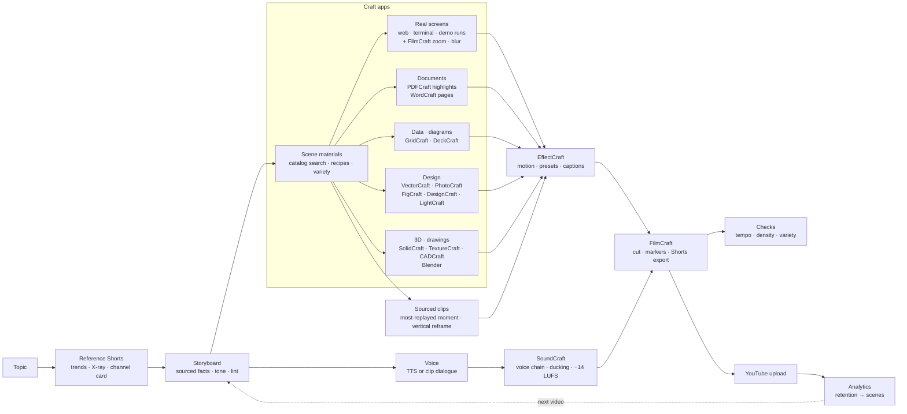
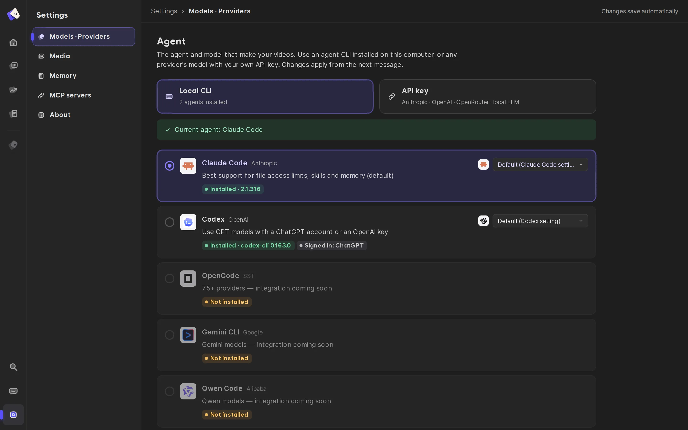

<div align="center">


# Fluma

**YouTube Shorts without having to pay for generative models — Fluma re-edits 2D graphics, images and footage that already exist, the way an editor would, and generates only the shots that truly need it, starting from cheap image drafts.**

[](LICENSE)
[](QUICKSTART.md)


[Quick start](QUICKSTART.md) · [Why Fluma](#why-fluma) · [How it works](#how-it-works) · [Contributing](CONTRIBUTING.md)

**English** · [한국어](README.ko.md)

</div>

<p align="center"></p>

## What is Fluma

A local agent workspace for vertical short-form video (YouTube Shorts, Reels, TikTok).
You talk to the **Claude Code or Codex** you already use. The agent studies Shorts that work, then turns **real material** — web screens, documents, data, photos, sourced clips, stock footage — into a video with open-source creative apps.
By default it uses no generative model (no generation bill), and everything it makes stays an editable project file. Only when a shot can't be built from real material does it use **one OpenRouter key** to show image drafts first and make the video from the one you pick.

## Why Fluma

Generative video models are great at scenes that don't exist. But a lot of Shorts are about **re-editing what already exists** — a real app screen, an original document, an exact number, a clip that went viral.
That is the niche Fluma is built for.

| | Generative video models | Fluma |
|---|---|---|
| Cost | Billed per second or per clip, more with every re-roll | **$0 generation** — your agent login, free voices, free stock |
| Text, numbers, logos | Often garbled or invented | Real documents, real screens, the actual data |
| Facts | No sources | A source URL for every fact; unsourced facts are dropped |
| Fixing | Change the prompt and regenerate | Edit one scene, layer or word (project files) |
| Consistency | Depends on the roll | Rhythm measured from references, gated by checks |
| Hardware | Cloud GPUs | An ordinary laptop (no GPU needed) |

**Good fit**

- **Tips and explainers** — tool comparisons, real screen recordings with zoom and highlights (`format-compare`)
- **Rankings and compilations** — the most-replayed moment of each sourced clip, reframed to 9:16, with reaction captions (`format-ranking`, `format-clip`)
- **Prices, news, daily videos** — data cards filled into a template every day (`format-daily`)
- **Evidence and documents** — highlights and zooms on the original PDF (PDFCraft)
- **Mood pieces and ads** — real photos or store footage with short lines (`format-emotional`, `format-ad`)
- **2D graphics and illustration** — drawings, diagrams and charts the agent draws itself in VectorCraft

**Shots that need generation** — scenes that never happened (fictional actors, imagined places) can't be built from real material. Fluma flags those shots and, if you want, starts with **image drafts**: a few keyframes (a few cents each) → you pick one → the video is made from it (the expensive step comes last). With an OpenRouter key Fluma does this itself with the models you chose (Seedance, Kling, Veo, Seedream, Nano Banana …); without one it writes the prompts in each model's syntax for your own tools. If the whole video has to be generated, use a generation tool directly.

## What it costs

| You need | Cost |
|---|---|
| Agent | The Claude Code or Codex login you already have (or an API key) |
| Voice | Free engines by default (Edge TTS, six local TTS engines); paid voices come through the one OpenRouter key (ElevenLabs, Gemini TTS, Fish Audio … picked in Settings) |
| Footage | Sourced clips (credited automatically), free Pexels and Pixabay keys, reference photos |
| Music | Finds the trending song Shorts in the same niche actually use, to attach from the Shorts editor's library at upload (licensed by YouTube) |
| Creative apps | 16 open-source [Craft apps](#the-craft-apps) plus Blender — free |
| (Optional) OpenRouter | One key for video understanding (reference analysis), images, video generation, voice and transcription. Pick a model per capability in Settings; above the per-video cap (default $3) the agent shows the amount and asks |

## What it does

1. **Studies real Shorts first** — finds Shorts on the topic and breaks them down (cuts, camera motion, color, speech, on-screen text, screen types). It borrows rhythm and tone, never content.
2. **Writes a storyboard from sourced facts** — in that channel's voice.
3. **Builds every scene in real tools** — 16 Craft apps and their 9,000+ commands, effects and presets: real screen recordings, annotated documents, diagrams, app mockups, info cards, 3D products, drawings. Then motion, sound and the cut.
4. **Reuses existing footage** — picks the most-replayed section of a sourced clip, reframes it to 9:16 following the subject, and keeps the original audio. Credits go into the description automatically.
5. **Makes each video different** — searches each app's full feature set per scene, prefers proven recipes recent videos haven't used, and flags repetition.
6. **Checks like a reviewer** — first second, stalls, speech gaps, cut density, with format-specific rules (rankings and clips differ).
7. **Uploads and learns** — posts to your channel and overlays the retention curve on the storyboard's scenes.

## Features

- 🔎 **References first, enforced** — a storyboard can't pass lint (`L30`) until real reference Shorts are analyzed and linked. Noun-ending lines and mixed politeness fail too (`L31`).
- 🧰 **The whole real toolset** — every stage leaves a Craft project file (`.ecproj` motion, `.scraft` sound, `.fcproj` cut, `.vectorcraft` drawing, `.psd`, `.deckcraft` …). Keep editing them; hand-edited files are detected by hash and never overwritten. When no material type fits, the agent writes app commands directly (`type: craft`).
- 👁️ **Eyes that watch video (VL)** — an OpenRouter vision model watches reference Shorts end to end and maps scenes, hooks, twists, editing grammar, caption tone and retention devices with timestamps; it also drafts the cliché map, finds the moment you want in a clip, critiques the draft (what feels off at which second, and why) and checks generated shots. The agent can ask it anything about any video (`see.py ask`).
- 🎞️ **Pick the feel** — the agent proposes 2–4 looks (documentary, dreamy, film …) and renders them side by side on the same scenes (`feel.py`). The chosen look is applied to all real footage and carried into generation prompts.
- ♻️ **Reuse editing** — automatic clip-moment picking (`clip.py --best`), subject-tracking vertical reframing (`reframe.py`), trending-song finder (`trend_music.py`), upload guide (`upload_guide.py`).
- 🎨 **You pick the look; effects need a reason** — the first scenes render as 2–3 design options side by side. Background motion, transitions and text animation stay off unless a reference or you ask for them.
- 🎲 **No two videos alike** — search every command, effect and preset (`craft_catalog.py`), proven recipes, overlap checks against recent videos (`V41–V45`).
- ⏱️ **Built for the Shorts feed** — every render is measured for a blank first frame, no change in the first second, long stalls and speech gaps (`L32`, `T32–T34`).
- 📈 **Real numbers feed the next video** — connect your channel with official OAuth to see views, average percentage viewed, traffic sources and **per-scene** retention.
- 💻 **Any computer** — Linux, macOS, Windows; Intel, AMD and ARM (Apple Silicon). Docker attaches a GPU when there is one and falls back to the CPU.
- 🌐 **Korean first, multilingual** — Korean tone analysis and caption grammar; UI in English, 한국어, 中文.
- 🔐 **Local first** — keys and YouTube tokens live in `~/.shortsforge/` (0600), out of the agent's reach.

## How it works



| Stage | Where | What it does |
|---|---|---|
| References | `engine/research/` (`trends.py`, `shorts_xray.py`, `ref_channel.py`) | find Shorts by topic, cuts · camera · colors · speech · BPM · screen kinds, channel tone card |
| Storyboard | `.claude/skills/plan`, `storyboard`, `engine/checks/lint.py` | scenes with `materials`, structural lint |
| Materials | `engine/craft/materials.py` + `engine/craft/adapters/<app>.py` | one adapter per Craft app; `type: craft` runs any command list |
| Variety | `engine/craft/craft_catalog.py`, `craft_variety.py`, `.claude/skills/crafts/` | 9,000+ features searchable, recipes, repetition checks, usage per video |
| Motion · sound · edit | `engine/craft/motion.py`, `audio.py`, `edit.py` | EffectCraft comps, SoundCraft mix, FilmCraft assembly |
| One command | `engine/produce.py` | voice → lint → materials · draft → still frame per scene |
| Checks | `engine/checks/` | first second · freezes · pauses · cut density; intent & draft gates |
| Publish & learn | `engine/publish/`, `studio/youtube.mjs` | OAuth, resumable upload, Analytics mapped to scenes |

## The editor

An IDE-style workspace: an **Explorer** tree of what the video is made of — *Edit · Preview*, *Sound* (narration · music), *Graphics*, *Illustrations*, *Photos*, *Data*, *Publish · Results* — and an editor area that shows the **result** of the selected item (the cut, the mix, the scene graphics, the drawing, the table, the stats). Changes go through the agent panel on the right; the selected item is passed to the agent as context. Editor tabs, breadcrumbs, a status bar and a resizable explorer (`Ctrl+B`).

<table>
<tr>
<td width="50%"><br/><sub><b>Models · Providers</b> — your local Claude Code / Codex CLI, or any API key.</sub></td>
<td width="50%"><br/><sub><b>Media</b> — free and paid voice engines, render engines.</sub></td>
</tr>
</table>

## The Craft apps

Fluma drives the open-source **Craft** desktop/web apps (by [storytold](https://github.com/storytold), MIT / Apache-2.0) through their CLIs and MCP servers. They are **not bundled** — install the ones you want (about 1.7 GB download for all 16):

```bash
python3 engine/craft/crafts.py plan all        # what would be downloaded, no download
python3 engine/craft/crafts.py install all     # or pick: install effectcraft soundcraft filmcraft …
```

| App | What Fluma uses it for |
|---|---|
| EffectCraft | motion of every scene — built-in background · entrance · text presets, screen frames, push-ins |
| SoundCraft | voice chain (EQ · compressor · de-esser), per-word sound effects, ducking, −14 LUFS |
| FilmCraft | assembly, scene markers, Shorts export, thumbnail; screen-recording zoom · blur · speed; color presets for clips |
| VectorCraft | illustrations drawn by the agent, annotation overlays (boxes · arrows · labels), CSV card batches |
| PhotoCraft | 9:16 scene cards from captures, cut-outs, text-to-alpha, watermark-free cleanups |
| PDFCraft | real highlights and boxes on source documents, cropped high-res evidence shots, redaction |
| WordCraft | document pages with highlights and tracked changes |
| GridCraft · DeckCraft | data for charts; SmartArt diagrams and tables |
| FigCraft · DesignCraft | phone / browser mock-ups; info cards and thumbnails with Korean typesetting |
| LightCraft | one look across all stills of a video |
| SolidCraft · TextureCraft · CADCraft | 3D product turntables and exploded views; floor plans and drawings |
| Blender | organic 3D shapes, characters and film-quality Cycles renders, scripted per video; SolidCraft parts, joints and TextureCraft materials flow into it (`engine/craft/bridge3d.py`) |

Every app's full command list is in `.claude/skills/crafts/catalog/` (`python3 engine/craft/craft_catalog.py search "curved arrow"`), with tested notes in `.claude/skills/crafts/reference/`. Releases are verified against their SHA256SUMS and unpacked into `tools/crafts/` (git-ignored).

## YouTube

Settings → **YouTube**: create an OAuth client in Google Cloud (enable *YouTube Data API v3* and *YouTube Analytics API*, Web application, redirect URI `http://127.0.0.1:4310/api/youtube/callback`), paste the client ID and secret, press **Connect**. Then:

- **Publish · Results** in the editor uploads the latest render (private by default) or links a video you already uploaded;
- **My channel videos** shows stats for any video on the channel.

Analytics fill in 1–2 days after publishing; *viewed vs. swiped away* itself is only in YouTube Studio, so Fluma shows *stayed-to-watch* = engaged views ÷ views as the closest API value.

## Quick start

Requirements: Python 3.10+, Node.js 20+, ffmpeg. Details and troubleshooting: [QUICKSTART.md](QUICKSTART.md).

```bash
git clone https://github.com/meowassassin/fluma && cd fluma
python3 engine/doctor.py --fix              # everything: Python packages · all 16 Craft apps · models · npm
npm --prefix studio run dev                     # → http://localhost:4311
```

- Which way to install (Docker · direct · development), what your computer needs, where your videos are: [QUICKSTART.md](QUICKSTART.md#pick-a-path)
- Minimal install: `python3 engine/doctor.py --fix --profile lite --core` (the rest installs itself on first use)
- Docker (everything included, adapts to OS and GPU): `sh docker/start.sh` (Linux, macOS) or `docker\start.ps1` (Windows)
- Or let your own agent install it: give Claude Code / Codex this skill — https://raw.githubusercontent.com/meowassassin/fluma/main/docs/skill/SKILL.md

## Skills

| Skill | What it does |
|---|---|
| `plan` | plans a video in chat; studies reference Shorts before writing |
| `storyboard` | writes the storyboard JSON: format, research, scenes, materials, lint loop |
| `produce` | Craft pipeline: voice → scene materials → lint → draft render → still-frame check |
| `crafts` | which Craft app and feature to use for a scene; catalog search, recipes, variety rules |
| `illustrate` | draws characters / props as a designer in VectorCraft, render-and-fix loop |
| `research` | collects facts with source URLs; fewer than five sources → the topic is dropped |
| `trends` | finds Shorts by topic or hashtag for the Trends screen |
| `voice` · `scene-edit` · `character` | narration fitting, one-scene edits, lip-synced mascot |
| `refine` | polish each scene after the draft (try → compare before/after → keep) |
| `format-*` | ready formats: compare, daily price, ad, emotional, ranking, clip reaction |

## Project layout

```text
fluma/
├─ engine/                 Python production engine
│  ├─ produce.py           one command: storyboard → voice → lint → draft → stills
│  ├─ render.py · pipeline.py · doctor.py · fluma_agent.py · mcp_server.py
│  ├─ craft/               Craft pipeline — materials · motion · audio · edit · design.py (effects per video) · adapters/<app>.py
│  │  ├─ apps/             the 16 Craft apps (craft.json each)
│  │  ├─ renderer/         render-engine entry (engine.json · adapter)
│  │  └─ craft_catalog.py · craft_variety.py · crafts.py
│  ├─ voice/               TTS · audio assembly · voice matching · engines/<voice> · sfx
│  ├─ research/            trends · Shorts X-ray · reference style & channel cards
│  ├─ capture/             web / terminal recording · demo runs · sourced clips · vertical reframing · memes · stock · icons
│  ├─ story/               storyboard helpers — concepts · feel (feel.py) · design drafts (directions.py) · variants · tone edit
│  ├─ gen/                 generation — per-model prompts · image drafts → pick → video (OpenRouter) · checks on uploaded clips
│  ├─ providers/           one OpenRouter key — models per capability · chosen model · cost gate (estimate → approve → ledger)
│  ├─ checks/              lint · tempo · edit density · gates
│  ├─ publish/             YouTube upload
│  ├─ core/                shared — results protocol · engines registry · finish · stills · install
│  └─ spec/                schema · rules · presets · tokens
├─ studio/                 web app — React UI (src/), API server, agent harness (agent/system.md)
├─ .claude/skills/         agent skills (plan · storyboard · produce · crafts · …)
├─ data/                   everything made while working (git-ignored) — see data/README.md
├─ docker/                 Dockerfile · docker-compose.yml · start.sh · start.ps1 (adapts to OS and GPU)
├─ docs/  tests/
└─ tools/                  installed Craft apps (git-ignored)
```

| Layer | Stack |
|---|---|
| Studio UI | React + Vite (`studio/src`), i18n en / ko / zh |
| API & agent runtime | Node / Express (`studio/server.mjs`, `studio/agent.mjs`) — local CLIs or API providers, Craft apps as MCP servers |
| Engine | Python (`engine/`) — one renderer: the Craft pipeline |
| Plug-ins | one folder each: `engine/craft/apps/<app>/craft.json`, `engine/craft/adapters/<app>.py`, `engine/voice/engines/<name>/` |

## Roadmap

- [x] Reference-first storyboard with enforced checks (L30 · L31)
- [x] Craft app pipeline with editable project files and hand-edit protection
- [x] IDE-style editor with per-item results
- [x] YouTube connect · upload · analytics mapped to scenes
- [x] Render-time tempo checks for the Shorts feed
- [ ] Use past videos' per-scene drop-off automatically when planning hooks
- [ ] Layout polish: pinned topic title, circle highlight on photos, keyword-colored captions
- [ ] One complete public demo with its hand-work and performance numbers
- [x] Linux, macOS, Windows and ARM CI; amd64 and arm64 Docker images
- [x] Clip reuse: most-replayed moments, vertical reframing, trending-song guide

## Contributing

**Everyone's welcome — no permission needed.** Fork it, change it freely, send PRs, experiments, fixes, translations or ideas. See [CONTRIBUTING.md](CONTRIBUTING.md).

## Status

Early and opinionated. CI covers Linux (x86, ARM), macOS, Windows and Docker. Reference videos are analyzed for *structure*; their footage, voices, drawings and scripts are never copied — rights to sourced clips, memes, music and logos stay with their owners and using them is your call (credits are added to the description automatically).

## License

Apache-2.0 — see [LICENSE](LICENSE) and [NOTICE](NOTICE). The Craft apps are separate projects under their own licenses.
