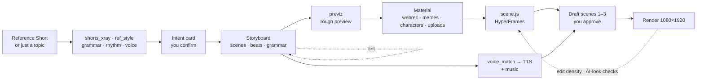

<div align="center">


# Fluma

**Paste a reference Short. Fluma measures its editing grammar and remakes your topic in it — from real material, previewed before you build, checked against human-edited Shorts.**

[](LICENSE)
[](QUICKSTART.md)


[](CONTRIBUTING.md)

[Quick start](QUICKSTART.md) · [Contributing — all welcome](CONTRIBUTING.md) · [How it works](#how-it-works)

**English** · [한국어](README.ko.md)

</div>

<p align="center"></p>

## What is Fluma

Fluma is a local-first agent workspace for short-form video (YouTube Shorts · Reels · TikTok).
You chat with an agent (your own Claude Code / Codex CLI, or any API key). It analyzes a reference Short or channel,
writes a storyboard for *your* topic, shows a rough **preview** before anything expensive happens, composes every scene
as code (HyperFrames), narrates it, mixes music, checks the result against numbers measured from human-edited Shorts,
and renders a 1080×1920 MP4.

Fluma does **not** generate live-action video. It builds Shorts from 2D graphics and reused material:
real website screen recordings, memes, characters, library elements and your own uploads — so on-screen facts, UI and
numbers are real, not hallucinated.

## Why Fluma

- 🎯 **Reference grammar, measured** — caption bands (fixed title, punchline box, bracket labels, reaction subtitles),
  their position / size / color, cut rhythm, music BPM and sentence endings are extracted as numbers from a reference
  Short or a whole channel, then reused. No hand-tuned "template look".
- 🧾 **Real material, not generated guesses** — `webrec` drives a real browser and records the screen; zoom follows the
  words being spoken and targets on-screen text, not hand-picked coordinates. Facts need a source URL or they're dropped.
- 🎬 **Preview before you build** — `previz` renders the storyboard alone: missing material shows as a labeled
  placeholder, captions / timing / voice are already final. Fix the structure before recording anything.
- 📏 **Checked against human-edited Shorts** — "slide-like" output (tiny text, one material type, nothing changing)
  and "AI look" (tilts, glows, blur-ins, gradients) are measured on the rendered frames and block the final render.
- 💬 **Edit by talking** — point at the preview and say what to change; one scene or one word is re-done, not the video.
  Every human action is logged, so "how much hand-work did this take" is a number.
- 🎵 **Voice and music** — free Edge TTS or Typecast / ElevenLabs / Gemini TTS, voice matched to the reference speaker
  (pitch, intonation, endings — no cloning); background music mixed under narration with ducking and fades.
- 🌐 **Korean-first, multilingual** — Korean tone analysis and caption grammar; UI in English, 한국어 and 中文.
- 💸 **Free path, local-first** — Edge voice + local render + free 2D models; keys stay in `~/.shortsforge/` (0600),
  the agent cannot read them.

## How it works



| Stage | Tool | What it measures or makes |
|---|---|---|
| Analyze | `scripts/shorts_xray.py`, `ref_style.py`, `ref_channel.py` | cuts, speech, music BPM, caption bands, screen kinds (CLIP), channel card over several videos |
| Plan | `scripts/format_presets.py`, `lint.py` | layout numbers per format (IT explainer, cooking, news, science), structural lint |
| Preview | `scripts/previz.py` | storyboard-only preview with placeholders, using the reference's caption grammar |
| Material | `scripts/webrec.py`, `meme.py`, `.claude/skills/character` | real browser recordings with text positions, memes with source credits, SVG characters with lip-sync |
| Voice & music | `scripts/voice_match.py`, `assemble_audio.py`, `finish.py` | voice matched to the reference speaker, word timings, music with ducking |
| Check | `scripts/edit_density.py`, `look_check.py`, `gate.py`, `effort.py` | text size / material variety vs. human Shorts, AI-look tells, intent & draft gates, human-action log |

## Product tour

<table>
<tr>
<td width="50%"><br/><sub><b>Models · Providers</b> — run on your local Claude Code / Codex CLI, or any API key.</sub></td>
<td width="50%"><br/><sub><b>Media</b> — voice engines (free and paid), free 2D models, render engines.</sub></td>
</tr>
</table>

> A full demo Short (reference → preview → final, with its numbers) is in progress. We'd rather show one honest result
> with its hand-work count than a gallery of cherry-picked clips.

## Quick start

Requirements: Python 3.10+, Node.js 20+, ffmpeg. Details and troubleshooting: [QUICKSTART.md](QUICKSTART.md).

```bash
git clone <this repo> fluma && cd fluma
python3 scripts/doctor.py --fix              # lite: storyboard · free Edge voice · HyperFrames · render · checks
npm --prefix web run dev                     # → http://localhost:4311
```

- Reference analysis (transcription, OCR, CLIP shot tags): `python3 scripts/doctor.py --fix --profile analysis`
- Docker: `docker compose up --build` — see [`docker-compose.yml`](docker-compose.yml)
- What takes disk space and what is safe to remove: `python3 scripts/doctor.py --sizes`

## Use Fluma from your coding agent

| Way | How |
|---|---|
| Agent skill | [`skills/reference-to-shorts/`](skills/reference-to-shorts/SKILL.md) — the reference / channel analysis on its own, next to HyperFrames or Remotion skills |
| MCP server (stdio) | `python3 scripts/mcp_server.py` — tools `analyze_reference`, `channel_card`, `style_card`, `voice_profile` |
| Inside the app | Settings → Models · Providers: Claude Code, Codex CLI, or an API key (Anthropic, OpenAI, OpenRouter, Gemini, local Ollama …) |

## Skills

| Skill | What it does |
|---|---|
| `plan` | plans a video in chat: one question at a time, hook drafts scored, storyboard draft |
| `storyboard` | writes / rewrites the storyboard JSON: format, research check, scenes, lint loop |
| `compose` | composes each scene as code with the Fluma Kit and checks it on still frames |
| `voice` | narration voice, fitted to scene lengths |
| `scene-edit` | changes one scene only, keeping the rest and the total length |
| `character` | draws a mascot / host as SVG parts that lip-sync to the narration |
| `research` | collects facts with source URLs; fewer than five sources → the topic is dropped |
| `trends` | finds trending Shorts and shows them in the Trends screen |
| `format-*` | ready formats: compare, daily price, ad, emotional |

## Architecture

| Layer | Stack |
|---|---|
| Studio UI | React + Vite (`web/src`), i18n en / ko / zh |
| API & agent runtime | Node / Express (`web/server.mjs`, `web/agent.mjs`) — local CLIs or API providers |
| Pipeline | Python scripts (`scripts/`) — analysis, lint, voice, previz, render, checks |
| Render | HyperFrames (HTML → video) with the Fluma Kit (`engines/hyperframes/lib/kit.js`); Manim as a layer element |
| Plug-ins | one folder each: `voices/<name>/`, `genmodels/<name>/` (free 2D models), `engines/<name>/` |
| Schemas | `schema/storyboard.schema.json`, `schema/scene.schema.json` |

## Roadmap

- [x] Reference / channel analysis → measured caption grammar and rhythm
- [x] Real-screen recording with word-timed zoom on on-screen text
- [x] Storyboard-only preview (previz)
- [x] Edit-density and AI-look checks against human-edited Shorts
- [x] Background music with ducking · UI in English / 한국어 / 中文
- [ ] One complete public demo with its hand-work, time and quality numbers
- [ ] One-command Docker run verified on a clean machine
- [ ] macOS / Windows CI (install check, tests, a short render)
- [ ] One-line installer

## Contributing

**Everyone's welcome — no permission needed.** Fork it, modify it freely, and send PRs, new features, improvements,
experiments, fixes, translations or just ideas. Draft PRs and rough first attempts are more than fine.
See [CONTRIBUTING.md](CONTRIBUTING.md) for easy entry points.

## Status

Early and opinionated. Tested on Linux only (the code handles macOS / Windows paths, but nobody has run it there yet).
Reference videos are analyzed for *structure*; their footage, voices and scripts are never copied into your video —
rights to memes, music, logos or footage you add yourself are your responsibility.

## License

Apache-2.0 — see [LICENSE](LICENSE) and [NOTICE](NOTICE) for third-party components.
