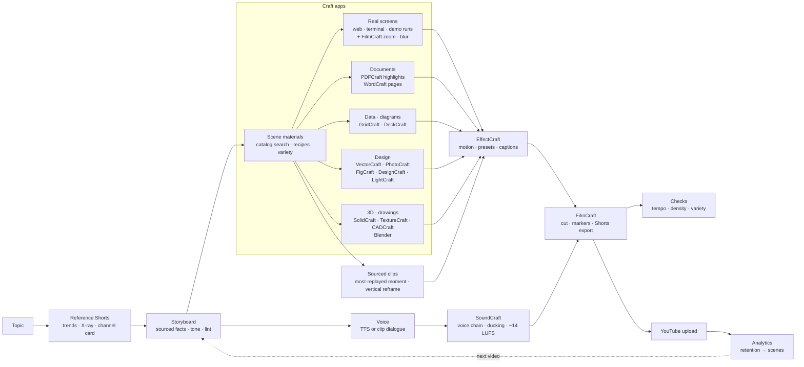

<div align="center">


# Fluma

**An agent that makes YouTube Shorts the way an editor would — studying real Shorts first, then building every scene in real creative tools, and learning from how the video actually performed.**

[](LICENSE)
[](QUICKSTART.md)


[](CONTRIBUTING.md)

[Quick start](QUICKSTART.md) · [How it works](#how-it-works) · [Contributing — all welcome](CONTRIBUTING.md)

**English** · [한국어](README.ko.md)

</div>

<p align="center"></p>

## What is Fluma

Fluma is a local-first agent workspace for vertical short-form video (YouTube Shorts · Reels · TikTok).
You chat with an agent (your own Claude Code / Codex CLI, or an API key). It:

1. **studies real Shorts first** — finds Shorts on the same topic, breaks them down (cuts, camera moves, colors, speech, on-screen text, screen types) and takes their rhythm and tone, never their content;
2. **writes a storyboard** with sourced facts, in that channel's spoken style;
3. **builds every scene in real creative tools** — 16 open-source [Craft apps](#the-craft-apps) and their 9,000+ commands, effects and presets: real screen recordings, annotated documents, diagrams, app mock-ups, info cards, 3D products, drawings — then motion graphics, a sound mix and a cut edit, each as an editable project file;
4. **keeps every video different** — searches the apps' full feature list per scene, picks verified recipes the recent videos did not use, and warns when a video repeats itself;
5. **uses real footage for live action** — sourced short clips (the most-replayed moment, reframed to vertical), free stock video and archive photos; the background song is the one Shorts in the same niche actually attach, added in the Shorts editor at upload;
6. **checks the render** like a reviewer — the first second, freezes, gaps in speech, cut density;
7. **publishes and learns** — uploads to your channel and maps the retention curve back onto the storyboard's scenes.

Fluma itself does not generate live-action video. Facts need a source URL or they are dropped.

## Why Fluma

- 🔎 **Reference first, enforced** — a storyboard fails the check (`L30`) until real reference Shorts have been analyzed and linked; narration that ends on a bare noun or mixes polite and casual speech fails too (`L31`).
- 🧰 **Real tools, all of them** — every stage is a project file in a Craft app (`.ecproj` motion, `.scraft` audio, `.fcproj` cut, `.vectorcraft` art, `.psd`, `.deckcraft` …). Open any of them and keep editing; Fluma notices hand edits by hash and never overwrites them. When a fixed material type is not enough, the agent writes the app's commands directly (`type: craft`).
- 🎨 **You pick the look, effects need a reason** — before the full draft Fluma renders 2–3 design drafts of the first scenes (as measured from the reference · plain · a little motion) side by side and you choose; background motion, transitions, text animation, shadows and push-ins stay off unless the reference or you ask for them (`engine/craft/design.py`, `engine/story/directions.py`). The same material can be made by a different app (`method`, e.g. charts by GridCraft or DeckCraft).
- 🎲 **No two videos alike** — a searchable catalog of every command, effect and preset (`craft_catalog.py`), verified recipes, and variety checks (`V41–V45`) against your recent videos; actual feature usage is recorded per video.
- 🎬 **Better than "write me a video prompt"** — prompts are compiled per model from what Fluma measured in the reference (shot length, camera moves, real colors, light), with edit handles, caption-safe zones, character locks and last-frame continuity; uploaded clips are checked against the shot plan.
- ⏱️ **Built for the Shorts feed** — every render is measured for an empty first frame, no change in the first second, long freezes and pauses (`L32`, `T32–T34`).
- 📈 **Closes the loop with real numbers** — connect your channel (official OAuth), upload, and see views, engaged views, average % viewed, traffic sources and the retention curve **per storyboard scene**.
- 🌐 **Korean-first, multilingual** — Korean tone analysis and caption grammar; UI in English, 한국어 and 中文.
- 🔐 **Local-first** — keys and YouTube tokens live in `~/.shortsforge/` (0600); the agent cannot read them.

## How it works



| Stage | Where | What it does |
|---|---|---|
| References | `engine/research/` (`trends.py`, `shorts_xray.py`, `ref_channel.py`) | find Shorts by topic, cuts · camera · colors · speech · BPM · screen kinds, channel tone card |
| Storyboard | `.claude/skills/plan`, `storyboard`, `engine/checks/lint.py` | scenes with `materials`, structural lint |
| Materials | `engine/craft/materials.py` + `engine/craft/adapters/<app>.py` | one adapter per Craft app; `type: craft` runs any command list |
| Variety | `engine/craft/craft_catalog.py`, `craft_variety.py`, `.claude/skills/crafts/` | 9,000+ features searchable, recipes, repetition checks, usage per video |
| Motion · sound · edit | `engine/craft/motion.py`, `audio.py`, `edit.py` | EffectCraft comps, SoundCraft mix, FilmCraft assembly |
| One command | `engine/produce.py` | voice → lint → materials · draft → still frame per scene |
| Checks | `engine/checks/` | first second · freezes · pauses · cut density; intent & draft gates |
| Publish & learn | `engine/publish/`, `studio/youtube.mjs` | OAuth, resumable upload, Analytics mapped to scenes |

## The editor

An IDE-style workspace: an **Explorer** tree of what the video is made of — *Edit · Preview*, *Sound* (narration · music), *Graphics*, *Illustrations*, *Photos*, *Data*, *Publish · Results* — and an editor area that shows the **result** of the selected item (the cut, the mix, the scene graphics, the drawing, the table, the stats). Changes go through the agent panel on the right; the selected item is passed to the agent as context. Editor tabs, breadcrumbs, a status bar and a resizable explorer (`Ctrl+B`).

<table>
<tr>
<td width="50%"><br/><sub><b>Models · Providers</b> — your local Claude Code / Codex CLI, or any API key.</sub></td>
<td width="50%"><br/><sub><b>Media</b> — free and paid voice engines, render engines.</sub></td>
</tr>
</table>

## The Craft apps

Fluma drives the open-source **Craft** desktop/web apps (by [storytold](https://github.com/storytold), MIT / Apache-2.0) through their CLIs and MCP servers. They are **not bundled** — install the ones you want (about 1.7 GB download for all 16):

```bash
python3 engine/craft/crafts.py plan all        # what would be downloaded, no download
python3 engine/craft/crafts.py install all     # or pick: install effectcraft soundcraft filmcraft …
```

| App | What Fluma uses it for |
|---|---|
| EffectCraft | motion of every scene — built-in background · entrance · text presets, screen frames, push-ins |
| SoundCraft | voice chain (EQ · compressor · de-esser), per-word sound effects, ducking, −14 LUFS |
| FilmCraft | assembly, scene markers, Shorts export, thumbnail; screen-recording zoom · blur · speed; color presets for clips |
| VectorCraft | illustrations drawn by the agent, annotation overlays (boxes · arrows · labels), CSV card batches |
| PhotoCraft | 9:16 scene cards from captures, cut-outs, text-to-alpha, watermark-free cleanups |
| PDFCraft | real highlights and boxes on source documents, cropped high-res evidence shots, redaction |
| WordCraft | document pages with highlights and tracked changes |
| GridCraft · DeckCraft | data for charts; SmartArt diagrams and tables |
| FigCraft · DesignCraft | phone / browser mock-ups; info cards and thumbnails with Korean typesetting |
| LightCraft | one look across all stills of a video |
| SolidCraft · TextureCraft · CADCraft | 3D product turntables and exploded views; floor plans and drawings |
| Blender | organic 3D shapes, characters and film-quality Cycles renders, scripted per video; SolidCraft parts, joints and TextureCraft materials flow into it (`engine/craft/bridge3d.py`) |

Every app's full command list is in `.claude/skills/crafts/catalog/` (`python3 engine/craft/craft_catalog.py search "curved arrow"`), with tested notes in `.claude/skills/crafts/reference/`. Releases are verified against their SHA256SUMS and unpacked into `tools/crafts/` (git-ignored).

## YouTube

Settings → **YouTube**: create an OAuth client in Google Cloud (enable *YouTube Data API v3* and *YouTube Analytics API*, Web application, redirect URI `http://127.0.0.1:4310/api/youtube/callback`), paste the client ID and secret, press **Connect**. Then:

- **Publish · Results** in the editor uploads the latest render (private by default) or links a video you already uploaded;
- **My channel videos** shows stats for any video on the channel.

Analytics fill in 1–2 days after publishing; *viewed vs. swiped away* itself is only in YouTube Studio, so Fluma shows *stayed-to-watch* = engaged views ÷ views as the closest API value.

## Quick start

Requirements: Python 3.10+, Node.js 20+, ffmpeg. Details and troubleshooting: [QUICKSTART.md](QUICKSTART.md).

```bash
git clone https://github.com/meowassassin/fluma && cd fluma
python3 engine/doctor.py --fix              # everything: Python packages · all 16 Craft apps · models · npm
npm --prefix studio run dev                     # → http://localhost:4311
```

- Which way to install (Docker · direct · development), what your computer needs, where your videos are: [QUICKSTART.md](QUICKSTART.md#pick-a-path)
- Minimal install: `python3 engine/doctor.py --fix --profile lite --core` (the rest installs itself on first use)
- Docker (everything included): `cd docker && docker compose pull && docker compose up -d`
- Or let your own agent install it: give Claude Code / Codex this skill — https://raw.githubusercontent.com/meowassassin/fluma/main/docs/skill/SKILL.md

## Skills

| Skill | What it does |
|---|---|
| `plan` | plans a video in chat; studies reference Shorts before writing |
| `storyboard` | writes the storyboard JSON: format, research, scenes, materials, lint loop |
| `produce` | Craft pipeline: voice → scene materials → lint → draft render → still-frame check |
| `crafts` | which Craft app and feature to use for a scene; catalog search, recipes, variety rules |
| `illustrate` | draws characters / props as a designer in VectorCraft, render-and-fix loop |
| `research` | collects facts with source URLs; fewer than five sources → the topic is dropped |
| `trends` | finds Shorts by topic or hashtag for the Trends screen |
| `voice` · `scene-edit` · `character` | narration fitting, one-scene edits, lip-synced mascot |
| `format-*` | ready formats: compare, daily price, ad, emotional |

## Project layout

```text
fluma/
├─ engine/                 Python production engine
│  ├─ produce.py           one command: storyboard → voice → lint → draft → stills
│  ├─ render.py · pipeline.py · doctor.py · fluma_agent.py · mcp_server.py
│  ├─ craft/               Craft pipeline — materials · motion · audio · edit · design.py (effects per video) · adapters/<app>.py
│  │  ├─ apps/             the 16 Craft apps (craft.json each)
│  │  ├─ renderer/         render-engine entry (engine.json · adapter)
│  │  └─ craft_catalog.py · craft_variety.py · crafts.py
│  ├─ voice/               TTS · audio assembly · voice matching · engines/<voice> · sfx
│  ├─ research/            trends · Shorts X-ray · reference style & channel cards
│  ├─ capture/             web / terminal recording · demo runs · memes · stock footage · icons
│  ├─ story/               storyboard helpers — direction · design drafts (directions.py) · variants · tone edit
│  ├─ checks/              lint · tempo · edit density · gates
│  ├─ publish/             YouTube upload
│  ├─ core/                shared — results protocol · engines registry · finish · stills · install
│  └─ spec/                schema · rules · presets · tokens
├─ studio/                 web app — React UI (src/), API server, agent harness (agent/system.md)
├─ .claude/skills/         agent skills (plan · storyboard · produce · crafts · …)
├─ data/                   everything made while working (git-ignored) — see data/README.md
├─ docker/                 Dockerfile · docker-compose.yml
├─ docs/  tests/
└─ tools/                  installed Craft apps (git-ignored)
```

| Layer | Stack |
|---|---|
| Studio UI | React + Vite (`studio/src`), i18n en / ko / zh |
| API & agent runtime | Node / Express (`studio/server.mjs`, `studio/agent.mjs`) — local CLIs or API providers, Craft apps as MCP servers |
| Engine | Python (`engine/`) — one renderer: the Craft pipeline |
| Plug-ins | one folder each: `engine/craft/apps/<app>/craft.json`, `engine/craft/adapters/<app>.py`, `engine/voice/engines/<name>/` |

## Roadmap

- [x] Reference-first storyboard with enforced checks (L30 · L31)
- [x] Craft app pipeline with editable project files and hand-edit protection
- [x] IDE-style editor with per-item results
- [x] YouTube connect · upload · analytics mapped to scenes
- [x] Render-time tempo checks for the Shorts feed
- [ ] Use past videos' per-scene drop-off automatically when planning hooks
- [ ] Layout polish: pinned topic title, circle highlight on photos, keyword-colored captions
- [ ] One complete public demo with its hand-work and performance numbers
- [ ] macOS / Windows CI

## Contributing

**Everyone's welcome — no permission needed.** Fork it, change it freely, send PRs, experiments, fixes, translations or ideas. See [CONTRIBUTING.md](CONTRIBUTING.md).

## Status

Early and opinionated. Tested on Linux only. Reference videos are analyzed for *structure*; their footage, voices, drawings and scripts are never copied — rights to memes, music, logos or footage you add yourself are your responsibility.

## License

Apache-2.0 — see [LICENSE](LICENSE) and [NOTICE](NOTICE). The Craft apps are separate projects under their own licenses.
